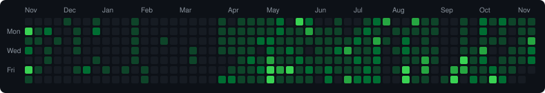

<!--
  ════════════════════════════════════════════════════════════════
  EDITORIAL PROFILE README — copy everything below into your
  profile repo's  README.md  (repo name must equal your username:
  SakithaSamarathunga33/SakithaSamarathunga33).
  Adapts automatically to light & dark GitHub themes.
  ════════════════════════════════════════════════════════════════
-->

# Sakitha Samarathunga

`ASSOCIATE SOFTWARE ENGINEER · SLIIT · SRI LANKA`

[](https://git.io/typing-svg)

I'm Sakitha Samarathunga, an Associate Software Engineer based in Gampaha, Sri Lanka, focused on full-stack development, artificial intelligence, cloud technologies, and scalable system architecture.

I build business systems and websites end to end — data models, APIs, and interfaces — and I obsess over making them feel fast and considered.

I also own the DevOps side: CI/CD pipelines, Docker, and self-hosted Linux servers behind reverse proxies, taking products from first commit to production.

My goal is to create innovative software products that solve real-world challenges and deliver meaningful user experiences. I learn fast, ship often, and care about the details. Portfolio: https://sakitha.tech

[](mailto:sakitha0303@gmail.com)
[](https://github.com/SakithaSamarathunga33)
[](https://www.linkedin.com/in/sakithasamarathunga/)
[](https://sakitha.tech)
[](https://instagram.com/__sakitha)

`● OPEN TO WORK & COLLABORATION`


&nbsp;

&nbsp;


---

## 01 · About

> **Clean code. Real problems. Elegant solutions.**

```typescript
const sakitha = {
  role:      "Associate Software Engineer",
  location:  "Sri Lanka",
  education: "SLIIT — 4th-Year IT Undergraduate",
  focus:     ["MERN", "Next.js", "AI/ML Integration", "Flutter"],
  learning:  ["System Design", "Cloud Architecture"],
};
```

- **Full-stack** — end-to-end web and mobile solutions across MERN, Next.js, Spring Boot and Flutter
- **AI / ML** — Facebook Prophet, scikit-learn and OpenRouter for forecasting, risk scoring and assistants
- **Data-driven** — analytics dashboards and visualization with Chart.js, fl_chart and friends
- Reach me at **sakitha0303@gmail.com**

---

## 02 · Stack

**Languages** &nbsp;


**Frontend** &nbsp;


**Backend** &nbsp;


**Data & Cloud** &nbsp;


**AI / ML** &nbsp;


**DevOps & Self-Hosting** &nbsp;


**Tools** &nbsp;


---

## 03 · GitHub activity

<!-- Stats + top languages — light and dark variants swap automatically -->
<picture>
  <source media="(prefers-color-scheme: dark)" srcset="https://github-readme-stats-seven-psi-50.vercel.app/api?username=SakithaSamarathunga33&show_icons=true&include_all_commits=true&count_private=true&hide_border=true&bg_color=00000000&title_color=39D353&icon_color=39D353&text_color=C9D1D9&cache_seconds=21600" />
  
</picture>
<picture>
  <source media="(prefers-color-scheme: dark)" srcset="https://github-readme-stats-seven-psi-50.vercel.app/api/top-langs/?username=SakithaSamarathunga33&layout=compact&langs_count=8&hide_border=true&bg_color=00000000&title_color=39D353&text_color=C9D1D9&cache_seconds=21600" />
  
</picture>

<!-- Streak -->
<picture>
  <source media="(prefers-color-scheme: dark)" srcset="https://streak-stats.demolab.com/?user=SakithaSamarathunga33&hide_border=true&background=00000000&ring=39D353&fire=39D353&stroke=39D353&currStreakLabel=39D353&sideLabels=C9D1D9&dates=8B949E&currStreakNum=E6EDF3&sideNums=E6EDF3" />
  
</picture>

<!-- Contribution graph -->


---

## 04 · Contact

**Open to collaborating on interesting projects — especially those combining full-stack development with AI/ML.**

[](mailto:sakitha0303@gmail.com)
[](https://www.linkedin.com/in/sakitha-samarathunga-b064a1279/)
[](https://sakitha.tech)

<sub>Designed & built by Sakitha Samarathunga</sub>
